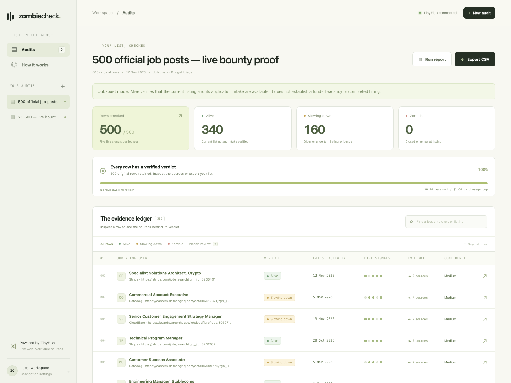

# Zombie Check

Check an old company or job spreadsheet against live pages, keep the original cells, and return verdicts with sources.

**Real proof, November 17, 2026:** 500 distinct official job posts audited; **340 alive, 160 slowing down, zero unresolved**. Every row has five checked signal categories and at least four verified observations. All original cells and their order survived export. Independent source reconciliation checked the exact posting ID, employer, intake fields and dates for all 500.



**Verification:** 154 offline tests pass; GitHub CI independently passes the suite, JavaScript syntax and recorded CSV check.

[Actual app recording (silent)](recording/app-recording-silent.mp4) · [ElevenLabs narration script](recording/elevenlabs-script.txt) · [Recording verification](recording/README.md)

## Inspect the proof

| Artifact | What it proves |
|---|---|
| [Real 500-row input](examples/jobs-500.csv) and [provenance](examples/jobs-500.provenance.json) | Distinct official postings selected without age or desired-verdict filtering |
| [Audited CSV](artifacts/jobs-audited.csv) | Same original spreadsheet plus verdict, dates, explanations and evidence |
| [Evidence JSONL](artifacts/jobs-evidence.jsonl) | Full per-row observations, scope, identity and localized-route traces |
| [Run report](artifacts/jobs-run-report.json) | Completion gates, coverage and recorded service calls |
| [Export verification](artifacts/jobs-export-verification.json) | Original headers, cells, IDs, count and order preserved |
| [Resume proof](artifacts/jobs-resume-proof.json) | 490 completed results unchanged while the remaining ten finished |
| [Source review](docs/SPOT_CHECKS.md) | Independent source reconciliation, corrections and limits |
| [Context refinement](artifacts/context-refinement-proof.json) | Better shared evidence without changing posting decisions or creating more datasets |
| [Independent Figma pilot](artifacts/figma-mapped-verification.json) | Custom headers and derived Greenhouse identities worked on another employer |
| [Budget ledger](artifacts/budget-report.json) | Conservative allocations below the chosen $5 overall ceiling |

The job demo contains 167 Stripe, 167 Datadog and 166 Cloudflare roles. It measures **public posting health**. It cannot establish funded headcount, recruiter intent, responses or successful application processing.

The older 500-company audit is retained as a **partial** experiment. It is not the completed 500-row proof. Source review caught a Sapling blog-only shutdown being misclassified as company closure; that verdict was withdrawn and a regression added. See [the correction](artifacts/sapling-correction.json).

## Run

Python 3.9+; Node 22+ for optional TinyBrowser inspection. Python and the web interface require no package installation.

```sh
git clone https://github.com/Sarvesh5273/Zombie-Check.git
cd Zombie-Check
export TINYFISH_API_KEY='your_personal_tinyfish_key'
python3 -m zombiecheck serve --port 8765
```

Open http://127.0.0.1:8765. Upload or paste CSV, choose company or job mode, map columns, select a spending cap, and start. The app shows saved audits, progress, review rows, filters, evidence and CSV/JSON reports.

CSV satisfies the bounty's CSV **or** Google Sheet input requirement. Inputs support up to 20 MB and 25,000 rows. Original columns, duplicates, Unicode, quoted/multiline cells and row order are preserved. Added headings receive a `zc_` prefix when they collide with an original heading.

Environment variables:

| Variable | Purpose |
|---|---|
| `TINYFISH_API_KEY` | Server-side TinyFish credential |
| `ZOMBIECHECK_BUDGET` | Default web spending cap; $5 |
| `ZOMBIECHECK_DB` | Checkpoint database; `data/zombiecheck.sqlite3` |
| `ZOMBIECHECK_ACCESS_TOKEN` | Required when exposing the paid API beyond localhost; requests use `X-Audit-Token` |

The application reads the process environment. Copying `.env.example` alone does not load it.

For Docker:

```sh
docker build -t zombie-check .
docker run --rm -p 8765:8765 -v "$PWD/data:/app/data" \
  -e TINYFISH_API_KEY -e ZOMBIECHECK_ACCESS_TOKEN zombie-check
```

Set the access token before running Docker, then enter it in the app's connection settings. Credentials and the database are excluded from Git.

## Company mode

Map company/tool/vendor name and website. The engine checks:

1. Blog/news: dated official updates.
2. Releases: changelog or release activity.
3. Hiring: official careers/ATS evidence.
4. Social/developer activity: an owned profile or repository.
5. Signup: registration entry text, with optional visible-control inspection.

TinySet researches exact company names/domains in saved batches. TinyFetch independently checks its suggested pages. Budget triage first checks the broader input and spends TinySet allowances on unresolved entities; full mode requests every distinct company.

Recent verified activity or operational evidence supports alive. Older activity on a working site supports slowing down. Explicit whole-company closure, discontinued original product or parking supports zombie. Cross-domain redirects require identity evidence; an acquired product does not silently borrow its parent's activity. Blocks, missing dates and contradictory evidence remain review items rather than invented verdicts.

## Job mode

Each exact role receives an independent fresh posting/API check, public-page check, official-board reconciliation and intake check. Employer blog/release/social evidence is shared, labeled `scope=employer`, and does not reset a role's age.

| Verdict | Job meaning |
|---|---|
| Alive | Exact official posting and configured application intake are available |
| Slowing down | Posting is still available but first published over 90 days ago; a disclosed caution heuristic |
| Zombie | Exact role is missing from a complete healthy official board and its detail returns 404/410 |
| Review | Conflicting identity, source blockage or insufficient evidence; no forced definitive verdict |

Age alone is not proof of a ghost vacancy. Administrative `updated_at` is exported as observed activity; `first_published` is kept separately. Original and current titles remain available.

The current exact-posting adapter supports **Greenhouse**. Native `boards.greenhouse.io/{token}/jobs/{id}` and `job-boards.greenhouse.io/{token}/jobs/{id}` URLs derive their ID, API and feed. Employer name and website must be supplied. Custom frontends require an official API URL, composite `greenhouse:token:id`, or board token with `gh_jid`. The app and CLI support arbitrary header mappings. Unsupported ATS providers are surfaced for review.

Localized missing routes are checked using actual posting metadata or exact official routes returned by Search. Host, posting ID and title must match. Original 404 evidence stays in the result; a matching Japanese/Korean page can resolve it. Unrelated redirects cannot become application evidence.

## How TinySet contributes

The 500-job run researches **three distinct employers once** in TinySet dataset `141b44ef-9950-4adb-81c8-3f779e06d94e`. Their structured source discovery is reconciled by exact name/domain, checked through fresh Fetch, and joined to all 500 jobs. Each posting's availability and intake are checked separately.

This is not a claim that TinySet independently researched 500 vacancies. Shared employer research keeps the demo inexpensive; judges may interpret the bounty's request to “fill hundreds” more strictly. This scope is disclosed in the submission.

TinySet's documented limits are 250 entities and ten columns per dataset. There is no documented CSV row-import endpoint. The app supplies an exact manifest, reconciles returned entities, and rejects substitutes.

## Meaningful services

- **TinySet:** structured employer/company source discovery and saved dataset IDs.
- **TinyFetch:** `ttl=0` live page/API checks; source bodies, final URLs, dates and errors saved.
- **TinySearch:** missing source and exact localized-route discovery; snippets are not verdict evidence.
- **TinyAgent:** a six-step inspection confirmed visible application controls on the exact Japanese Datadog posting; saved to its row.
- **TinyBrowser:** DOM inspection of public registration/intake controls; rejects newsletter-only forms and records cleanup.

The generic bounty scoring list names Search, Fetch, Agent, Browser and Monitor. Four conventional services contributed to the build. TinySet routes are not counted as separate scoring categories; final points remain the judges' decision.

Question definitions establish configured intake. Agent/Browser results separately state whether rendered controls were actually seen. No accounts or applications were created/submitted.

## Cost and recovery

The [budget ledger](artifacts/budget-report.json) records conservative reservations, including the initial TinySet pilot. It is not a settled invoice or a wallet-delta calculation; other bounty activity is excluded.

New audits enforce their combined cap for TinySet, Fetch/Search and optional inspection. TinySet is reserved at the recorded $0.10/entity rate; Search/Fetch are conservatively reserved even when a free allowance may apply. Full research of 500 distinct companies needs at least $50 for TinySet, plus verification; this build did not spend that amount.

SQLite preserves originals, results, source snapshots, remote run IDs, attempts and worker ownership. Completed rows are skipped on resume. Fresh source bodies are reused only within the same audit for recovery. Ambiguous paid creation is not blindly retried. Server restart preserves a healthy CLI worker and pauses abandoned workers.

## CLI and API

```sh
python3 -m zombiecheck import examples/jobs-500.csv --mode jobs --budget 2
python3 -m zombiecheck run AUDIT_ID
python3 -m zombiecheck resume AUDIT_ID
python3 -m zombiecheck report AUDIT_ID
python3 -m zombiecheck export AUDIT_ID --output audited.csv
```

For nonstandard headings:

```sh
python3 -m zombiecheck import examples/figma-mapped.csv --mode jobs \
  --name-column Role --url-column 'Apply Here' --budget 1 \
  --job-columns '{"employer":"Organization","employer_website":"Official Site"}'
```

`Ctrl+C` requests pause. Resume using the same database and audit ID. Global `--db` goes before the subcommand.

Optional inspection:

```sh
python3 -m zombiecheck inspect AUDIT_ID --row R000005 --method browser
python3 -m zombiecheck inspect AUDIT_ID --row R000005 --method agent
python3 -m zombiecheck inspect AUDIT_ID --row R000005 --method agent --run-id EXISTING_RUN_UUID
```

Agent uses a server-enforced six-step/60-second limit. The step limit requires TinyAgent beta; a 403 stays visible and does not cause an uncapped retry. A queued run's ID is persisted and may be polled through the same command. Supplying an existing run ID starts no new run.

| Method | Route | Action |
|---|---|---|
| POST | `/api/preview` | CSV validation, original preview and suggested mappings |
| POST | `/api/audits` | Save CSV, mode, mappings, strategy and budget |
| GET | `/api/audits` | Recent audits |
| GET | `/api/audits/{id}` | Status and counts |
| POST | `/api/audits/{id}/start` | Start/resume |
| POST | `/api/audits/{id}/pause` | Pause |
| GET | `/api/audits/{id}/rows` | Paginated originals and evidence |
| GET | `/api/audits/{id}/events` | Progress log |
| GET | `/api/audits/{id}/report` | Completion gates and usage |
| GET | `/api/audits/{id}/export` | CSV |

## Verify

```sh
python3 -m unittest discover -q
node --check web/app.js
node --check scripts/browser_signup.mjs
python3 scripts/verify_export.py --input examples/jobs-500.csv \
  --output artifacts/jobs-audited.csv --report artifacts/jobs-run-report.json
```

The export verifier checks structure. Independent source review checks evidence. A report's `submission_ready` means local data gates passed; it does not assert bounty approval or completion of social/submission obligations.

[Execution tracker](PLAN.md) · [Submission notes and exact social drafts](docs/SUBMISSION.md)
